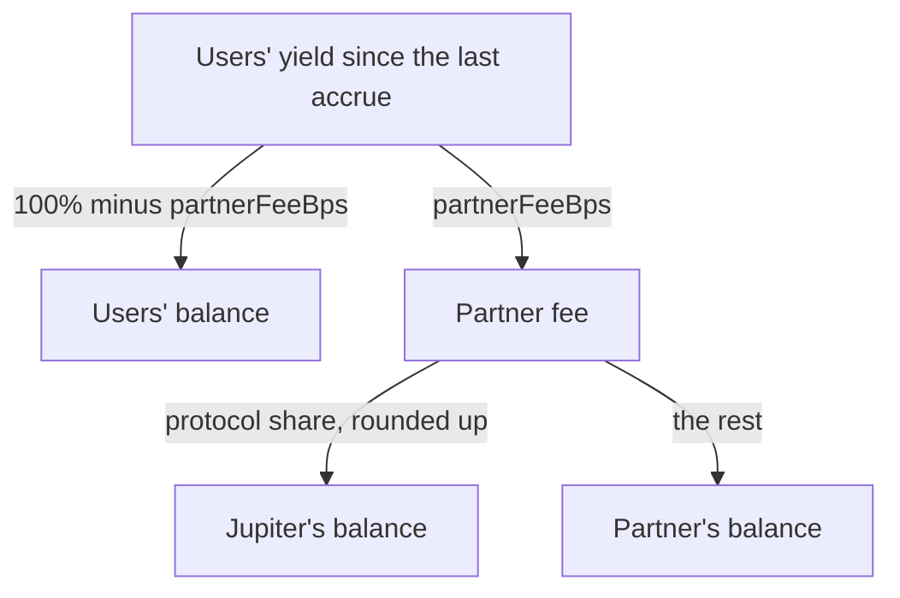

A Lend Referral wrapper takes your partner fee out of the yield your users earn, never out of their deposits. This page explains when the fee is charged, how it is split between you and Jupiter, where it sits until you claim it, and what fee your users pay in practice. It assumes you know what a wrapper is: see the [Lend Referral Overview](/lend/referral).

## How the fee is charged

The wrapper holds jlTokens (`fToken` in the SDK) for its users. Each jlToken is worth more underlying tokens over time, as Jupiter Lend Earn pays yield. The wrapper records the jlToken exchange price at its last checkpoint. At each **accrue**, it does two things:

1. It refreshes the Lend exchange price.
2. It charges the partner fee on the users' yield since the last checkpoint, and moves the new checkpoint to the current price.

An accrue runs at the start of every deposit, redeem and withdrawal, every claim, every `update_partner_fee`, and every call to the `accrue` instruction. Anyone can call `accrue`. It has no signer account, so only the transaction fee payer signs.

Only the users' balance pays the fee. The partner's and Jupiter's balances are already fee income, so their jlTokens keep earning Earn yield with no fee on it.

Integer rounding under-charges the fee by less than one jlToken atom per accrue, in the users' favour.

## How the fee is split

The partner fee is `partnerFeeBps` of the users' yield, at most 1000 bps (10%). Jupiter's **protocol share** comes out of the partner fee, not on top of it. The protocol share is at most 2500 bps (25%) of the partner fee, and it is currently 2500 bps.

For example, with a partner fee of 1000 bps and a protocol share of 2500 bps, each 100 units of user yield split as follows: the users keep 90, the partner gets 7.5, and Jupiter gets 2.5.

Jupiter can set a different protocol share for one wrapper. The share that applies to your wrapper is the field `protocolFeeShareBps` on the wrapper. See [Wrapper fields](/lend/referral/reference#wrapper-fields).

## Where fees sit until you claim

All of a wrapper's jlTokens stay in its vault, including the fees. The wrapper tracks the users' balance and Jupiter's balance. Your balance is whatever the vault holds beyond those two, and the program computes it when you claim. Two small amounts also add to your balance:

- On a redeem, the user's share of jlTokens can include a fraction of an atom. The wrapper pays whole atoms and leaves the fraction in your balance.
- jlTokens that anyone sends straight to the vault, outside a deposit, add to your balance. They do not change the xToken price.

Your fees keep earning Earn yield while they wait in the vault, and the wrapper takes no fee on them. A claim moves jlTokens from your balance to the stored fee recipient. To turn them into the underlying token, withdraw them on Earn: see [Withdraw from Earn](/lend/earn/withdraw). For the claim steps, see [Claim fees](/lend/referral/manage-wrapper#claim-fees).

The stored balances do not include the fee since the last accrue. To read current earnings, project the next accrue first, as shown in [Read your earnings](/lend/referral/manage-wrapper#read-your-earnings).

## Effective fee

Each accrue charges the fee on the yield of one interval. The charged jlTokens then compound in the fee balances with no fee. So the more often a wrapper accrues, the larger the share of total yield the fee takes over time.

Over a period where the jlToken price rises by a ratio R, with a fee fraction f (`partnerFeeBps / 10000`), the user's value grows by:

- 1 + (1 − f)(R − 1), if the wrapper accrues once at the end.
- R(1 − f), if the wrapper accrues continuously.

At `partnerFeeBps = 1000`, the effective fee as a share of gross yield is:

| Yearly yield | Accrued once | Accrued daily | Accrued every second |
|---|---|---|---|
| 5% | 10.00% | 10.22% | 10.22% |
| 20% | 10.00% | 10.84% | 10.84% |
| 100% | 10.00% | 13.38% | 13.39% |

At 5% a year the gap is about 0.2 percentage points. It grows with the yield.

<Note>
A wrapper with routine user activity accrues often enough to sit at the continuous rate. Quote fees to your users on that basis, not as the nominal `partnerFeeBps`.
</Note>

## When fee changes take effect

**Partner fee.** `update_partner_fee` accrues at the old fee first, so the new fee applies only to yield earned after the change. The change takes effect at once, with no delay, up to the 10% cap. Your users rely on your conduct within that cap. `update_partner_fee` is blocked while the protocol is paused. See [Change the partner fee](/lend/referral/manage-wrapper#change-the-partner-fee).

**Protocol share.** When Jupiter changes the protocol share, each wrapper picks up the new share at its next accrue. The yield pending since the last checkpoint splits at the old share. To apply a new share right away, call `accrue` on the wrapper. An idle wrapper keeps the old share until its next activity.

## Share price and the seed

An xToken is a claim on part of the users' balance. Its value in jlTokens is the users' balance divided by `totalXShares`: the xTokens in circulation plus the locked seed shares described below. The value rises as yield accrues, net of the fee.

Use `totalXShares` for this math, not the xToken mint supply. A holder can burn xTokens directly through the token program, which lowers the supply without changing `totalXShares`. The SDK math already uses `totalXShares`.

Every deposit and withdrawal rounds in the pool's favour: deposits round the xTokens they mint down, and exact withdrawals round the xTokens they burn up. Both leave small amounts of value in the pool.

When Jupiter creates a wrapper, it deposits a seed: more than 1,000,000 jlToken atoms and at most 10 whole jlTokens. The seed is booked as xToken shares that are never minted to anyone and can never be redeemed. So the wrapper starts at a price of one jlToken atom per xToken atom, and `totalXShares` never falls to zero.

The seed protects new wrappers against share-price manipulation. An attacker could try to push the share price up with many tiny round trips, so that later deposits lose more to rounding. To raise the price, the attacker has to add value to every share, the locked seed shares included, and that value stays locked with the seed. A larger seed makes the attack cost more.
