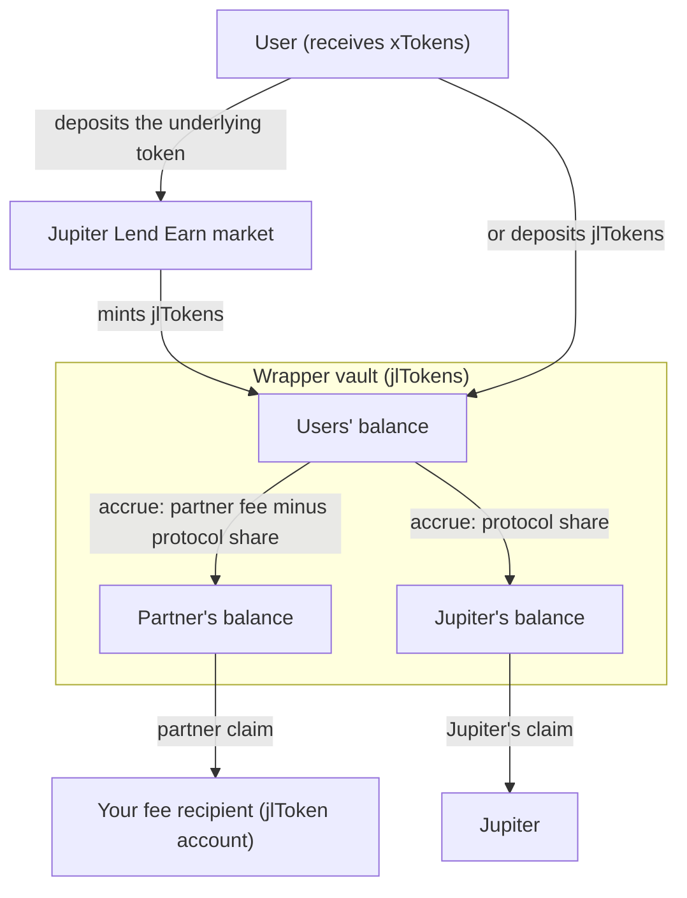
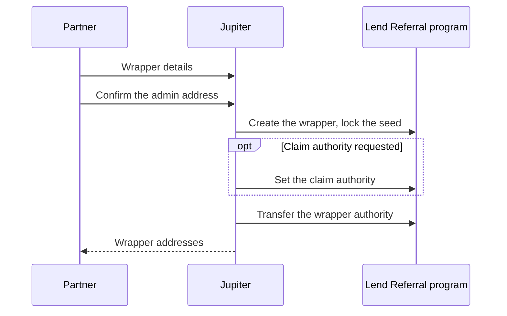

Lend Referral lets an app or wallet offer Jupiter Lend Earn yield under its own token, and take a fee on the yield its users earn. Jupiter creates a **wrapper** for you over one Earn market. Your users deposit the market's underlying token, such as USDC, or its jlToken (`fToken` in the SDK), and receive your **xToken** in return. The wrapper charges your **partner fee** on the yield and pays it to you, minus Jupiter's share.

This section is for two readers: the **partner** who owns a wrapper, and the front end that moves user funds through it. It assumes you know [Jupiter Lend Earn](/lend/earn) and jlTokens.

The Lend Referral program address is `LrefWFcNXGnLxnQUdKmuJ1U3fUrFBdNkm6xCfVfWwQW`. Lend Referral is a separate product from the [Jupiter Referral Program](/tool-kits/referral-program), which earns integrator fees on trades.

## How a wrapper works

A wrapper holds jlTokens for its users in a vault, one vault per wrapper. A deposit in the underlying token goes through the Earn market first, and the wrapper keeps the jlTokens Earn mints. A deposit in jlTokens goes straight to the vault. Either way, the user receives xTokens.

The vault's jlTokens are split into three balances: the users', the partner's, and Jupiter's. The jlTokens earn Earn yield. At each **accrue**, the wrapper takes the partner fee out of the yield on the users' balance and moves it to the two fee balances. An accrue runs at the start of every deposit, withdrawal and claim, and anyone can trigger one. You claim your balance to your fee recipient. Jupiter claims its own.

What this means for your users:

- **The xToken balance stays the same.** Yield shows up as a rising xToken value in jlTokens, net of the partner fee.
- **The xToken is a plain token.** It has the jlToken's decimals and the market's token program (Token or Token-2022). The wrapper is its mint authority, and it has no freeze authority.
- **Exits stay open.** A user can redeem xTokens for the underlying token or for jlTokens. If the underlying path is blocked, the jlToken exit still works. See [Exit in edge cases](/lend/referral/deposits-and-withdrawals#exit-in-edge-cases).

You get one wrapper per market. Several partners can wrap the same market, and each wrapper has its own xToken and vault, so code identifies a wrapper by its xToken mint. For how the fee is charged and split, see [Fees and Yield](/lend/referral/fees).

## Roles

| Role | Who | Can do |
|---|---|---|
| Jupiter | The protocol authority | Create wrappers. Set the protocol share, for all wrappers or for one. Pause and unpause the whole protocol. Claim the protocol share. |
| Wrapper authority | Jupiter at creation, then your admin address | Change the partner fee, the fee recipient and the claim authority. Rename the xToken. Transfer the wrapper authority. |
| Claim authority | Optional address you choose | Trigger partner claims. When it is set, only the claim authority, the wrapper authority, or the owner of the fee recipient account can trigger a claim. |
| Fee recipient | A jlToken token account you choose | Receives partner fees. |
| Users | Anyone | Deposit, redeem and withdraw. |
| Anyone | Any wallet | Call `accrue`. Trigger a partner claim when no claim authority is set. |

A claim always pays the stored fee recipient, whoever triggers it. That is why claims are open to anyone by default.

After Jupiter transfers the wrapper authority to you, Jupiter cannot change your partner fee, fee recipient, claim authority or xToken metadata. Jupiter keeps two controls over your wrapper: the protocol share, and the global pause. A pause blocks every deposit, redeem and withdrawal, `accrue`, and claims, for as long as it lasts.

## Get a wrapper

Jupiter creates every wrapper. To start, contact Jupiter through the [support form](https://support.jup.ag/requests/new).

### What you send Jupiter

| Item | Constraints |
|---|---|
| Market | One wrapper per Earn market, identified by the underlying mint. List each market you want. |
| Partner fee | 0 to 1000 bps, which is 0% to 10% of your users' yield. Jupiter's protocol share comes out of this fee, not on top of it. |
| Fee recipient | A wallet or multisig: Jupiter creates its jlToken associated token account if it is missing. Or an existing jlToken token account under the market's token program. The program rejects an account for another mint and the wrapper's own vault. |
| Wrapper admin address | Receives the wrapper authority. Use a multisig. Confirm this address with Jupiter out of band, for example with a signed message. |
| xToken name | At most 32 bytes. |
| xToken symbol | At most 10 bytes. |
| Metadata URI | Points to the Metaplex JSON (name, symbol, description, image). You host it, or Jupiter hosts it for you. At most 200 bytes. |
| Claim policy | Anyone can trigger claims (the default), or only a claim authority you name. You can change it later. |

### What Jupiter does

Jupiter seeds the wrapper with a small amount of jlTokens that stay locked in the vault permanently. The seed makes share-price manipulation on a new wrapper expensive (see [Share price and the seed](/lend/referral/fees#share-price-and-the-seed)). Jupiter then creates the xToken mint, the wrapper config and the vault, and writes the xToken metadata. It sets a claim authority if you asked for one, and transfers the wrapper authority to your admin address.

<Warning>
The wrapper authority transfer is one step and Jupiter cannot undo it. If it goes to a wrong address, you lose control of the wrapper permanently. Check the admin address before you send it.
</Warning>

### What you get back

- The **xToken mint** address. Your code passes it to the SDK to find your wrapper.
- The **wrapper config** address: the program PDA `["wrapper_config", xTokenMint]`.
- The market's **jlToken mint** and **Lending account**, the Earn market's on-chain account.
- The **vault** address: the wrapper config's associated token account for the jlToken mint.
- The **fee recipient** as stored on the wrapper.

## Integrate

<CardGroup cols={2}>
  <Card title="Fees and Yield" icon="percent" href="/lend/referral/fees">
    How the partner fee is charged, split and claimed, and what fee your users pay in practice.
  </Card>
  <Card title="SDK Quick Start" icon="code" href="/lend/referral/sdk">
    Install the SDK, read a wrapper, and send your first deposit.
  </Card>
  <Card title="Deposit and Withdraw" icon="arrow-right-arrow-left" href="/lend/referral/deposits-and-withdrawals">
    Move user funds in and out of a wrapper, with slippage bounds and edge cases.
  </Card>
  <Card title="Manage Your Wrapper" icon="sliders" href="/lend/referral/manage-wrapper">
    Read your earnings, claim fees, and change your wrapper's settings.
  </Card>
  <Card title="Reference" icon="book" href="/lend/referral/reference">
    Addresses, accounts, fields, limits, instructions, errors and events.
  </Card>
</CardGroup>
